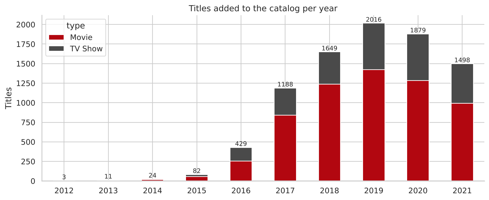
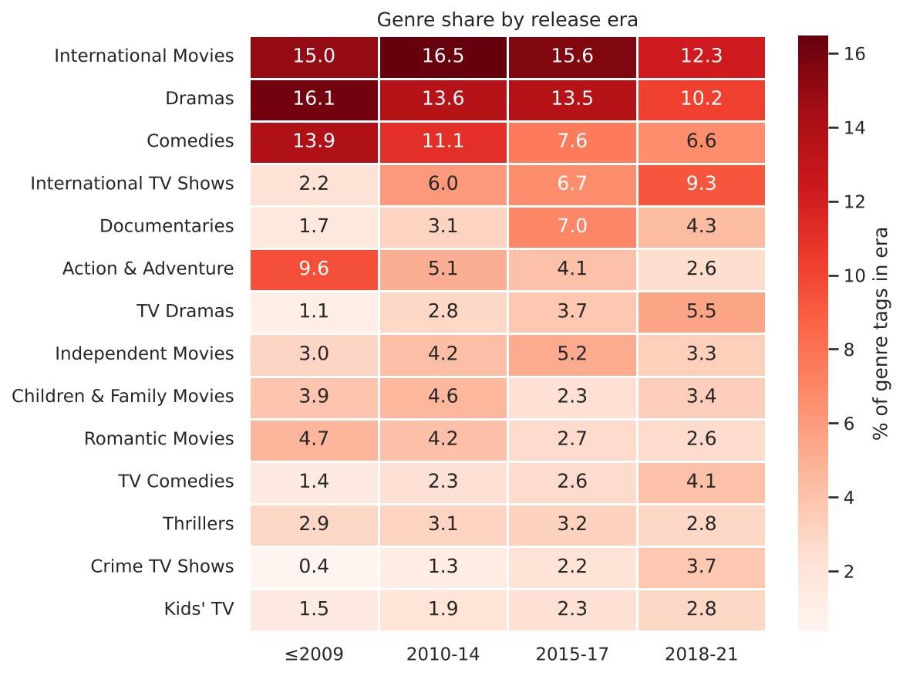
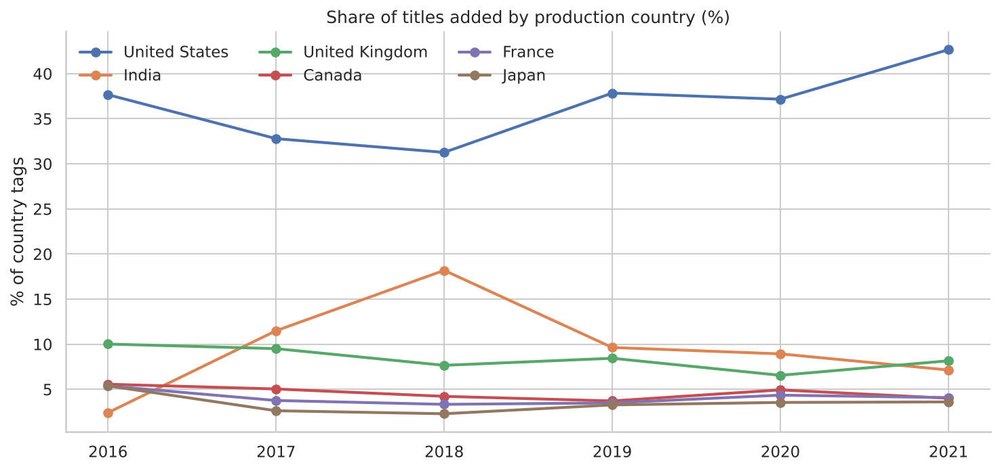
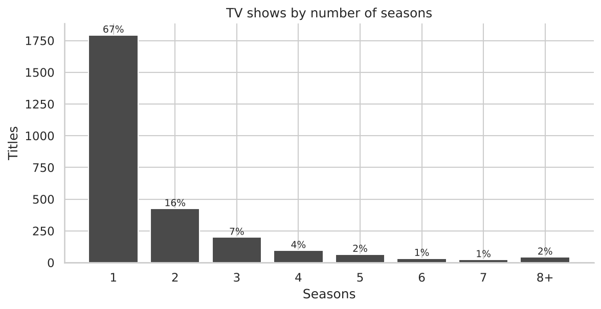

# 🎬 OTT Streaming Content Trend Analysis — Netflix Catalog

> An exploratory data analysis of 8,807 Netflix titles, written as a **content strategy memo** for an acquisition team: *what has changed in the catalog, and what should we greenlight next?*

**Author:** Radhika Dinesh Shet · **Track:** Data Analytics · Veda Technology Internship (Day 4 project)

---

## 🎯 Objective
Go from a raw catalog dump to a business narrative: genre popularity, content ratings, release trends, regional content mix and duration trends over the years, then convert the findings into recommendations.

## 🔑 Key findings

| # | Finding | Evidence |
|---|---|---|
| 1 | **Volume has peaked; TV is rising** | Titles added/year: 429 (2016) → 2,016 (2019) → 1,879 (2020). TV share of additions 25% (2018) → 34% (2021) |
| 2 | **Most series stop at season 1** | 67% of TV shows have 1 season; only ~10% reach 4+ |
| 3 | **India has a huge series gap** | India: 962 movies vs 84 shows (8% TV) vs South Korea 74% TV, Japan 63% TV |
| 4 | **International TV is the growth genre** | International TV Shows: 2.2% → 9.3% of genre tags (≤2009 → 2018-21 releases); Comedies −7.3 pp, Action −7.0 pp |
| 5 | **Movies got shorter, then plateaued** | ~116 min (pre-2000) → ~98 min since 2015 |
| 6 | **Content is more local-origin** | Multi-country co-productions: ~23% (2000s) → ~11% (2020-21) |

➡️ Full recommendations: [`memo/content_strategy_memo.md`](memo/content_strategy_memo.md)

## 📊 Sample visualizations
| | |
|---|---|
|  |  |
|  |  |

(10 visualizations + 1 bonus in the notebook; one chart is an interactive Plotly bar chart.)

## 📁 Repository structure
```
├── README.md
├── clean.py                         # reproducible cleaning pipeline (raw → clean tables)
├── requirements.txt
├── data/
│   ├── netflix_titles_raw.csv       # original dataset (Kaggle Netflix titles)
│   ├── netflix_titles_clean.csv     # cleaned + engineered features
│   └── title_genres / title_countries / title_cast / title_directors .csv   # exploded bridge tables
├── notebook/
│   ├── OTT_Content_Trend_EDA.ipynb  # main EDA notebook (executed, with outputs)
│   └── OTT_Content_Trend_EDA.html   # static export for easy viewing
├── sql/
│   ├── 01_setup_schema.sql          # table definitions
│   ├── 02_core_queries.sql          # 17 aggregation / JOIN / window-function queries
│   ├── run_queries.py               # loads CSVs into SQLite and runs every query
│   └── query_results.md             # output of all queries
├── memo/
│   └── content_strategy_memo.md     # 3 actionable insights for the acquisition team
└── images/                          # saved charts
```

## 🧹 Data cleaning & preprocessing
| Issue found | Fix |
|---|---|
| 3 rows with duration (e.g. `74 min`) stored in the `rating` column | Moved to `duration`, set rating to `Unknown` |
| `date_added` stored as text (10 missing) | Parsed to datetime; derived `year_added`, `month_added` |
| `duration` mixed units (`90 min` / `2 Seasons`) | Split into numeric `duration_min` (movies) and `n_seasons` (TV) |
| `director` (30%), `cast`, `country` (9%) missing | Filled with `Unknown`; director not used for conclusions |
| `rating` (4 missing + 3 shifted) | Set to `Unknown`; grouped all ratings into `audience` (Kids/Teens/Adults/Unrated) |
| `listed_in` & `country` comma-separated | Exploded into bridge tables (`title_genres`, `title_countries`) |
| No duplicates found | Verified: 0 duplicate rows, `show_id` unique |

**Engineered features:** `year_added`, `lag_years`, `duration_min`, `n_seasons`, `audience`, `primary_country`, `primary_genre`, `n_countries`, `is_international_coprod`, `release_era`.

## 🗄️ SQL
All core aggregations are written in SQL (`sql/02_core_queries.sql`) and validated in SQLite against the Python results. They cover `GROUP BY`, `JOIN`s across bridge tables, CTEs, and window functions (`RANK`, `SUM() OVER`). Run:
```bash
python sql/run_queries.py      # regenerates sql/query_results.md
```

## ▶️ How to reproduce
```bash
git clone <your-repo-url> && cd <repo>
pip install -r requirements.txt
python clean.py                                   # rebuild clean data
jupyter notebook notebook/OTT_Content_Trend_EDA.ipynb
python sql/run_queries.py
```

## ⚠️ Limitations
- Catalog data only — **no viewership**, so counts show what's offered, not what's watched.
- Titles added through **25 Sep 2021**; 2021 is a partial year.
- Genres/countries are multi-tagged, so shares are of *tags* not titles.
- 2008–2014 have very few additions, so early-year percentages are volatile.

## 🛠️ Tools
Python (pandas, NumPy, Seaborn, Matplotlib, Plotly) · SQL (SQLite) · Jupyter

## 📚 Dataset
Netflix Movies and TV Shows (Kaggle): 8,807 rows × 12 columns.
