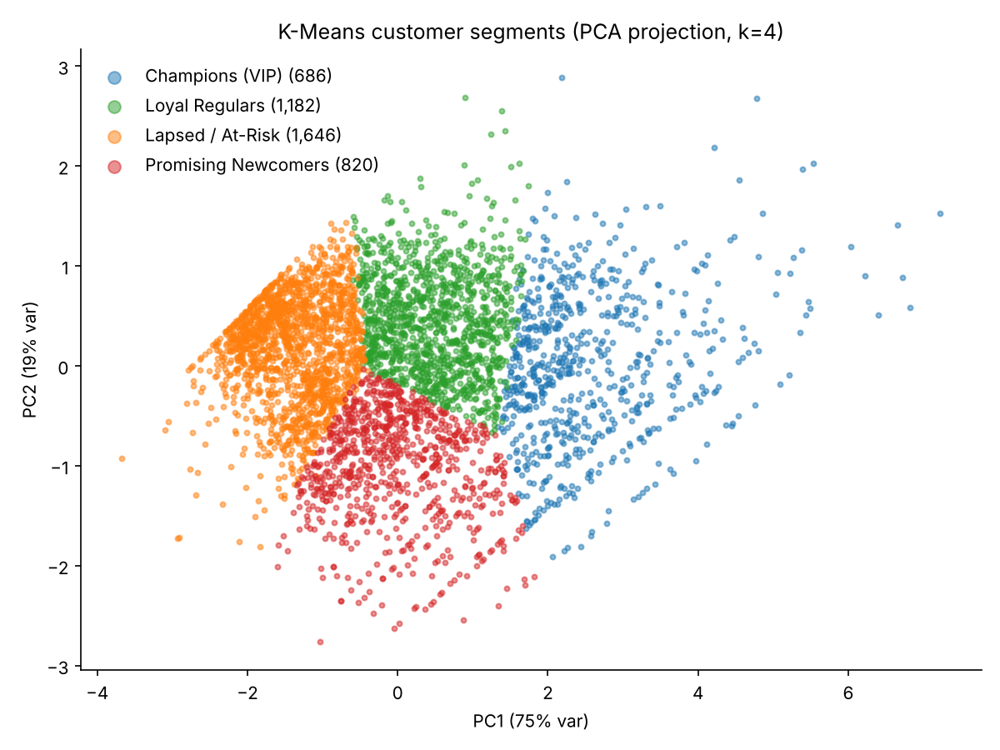
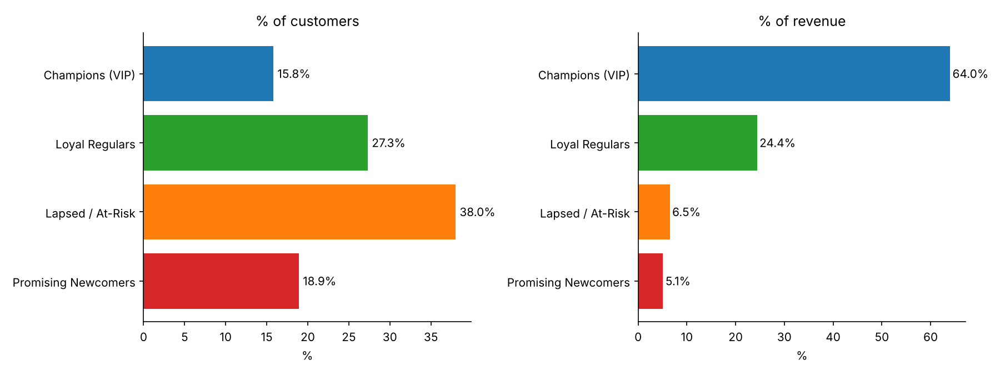

# 🛒 E-Commerce Customer Segmentation using RFM Analysis & K-Means

Segmenting 4,334 customers of a UK online retailer by **Recency, Frequency and Monetary value** to decide who gets a VIP perk, a nurture journey, or a win-back campaign.

**Track:** Data Analytics | **Tools:** Python (Pandas, Scikit-learn, Matplotlib), Excel, Power BI

---

## 📌 Business Problem
A marketing team has a limited budget. Sending the same offer to everyone wastes money on customers who would have bought anyway and ignores those about to leave. RFM segmentation answers: *which customers deserve which campaign, and why?*

## 📂 Dataset
[UCI Online Retail](https://archive.ics.uci.edu/dataset/352/online+retail): 541,909 transactions, 1 Dec 2010 - 9 Dec 2011, UK-based non-store online retailer (mostly wholesale gift buyers).

## 🧹 Data Preprocessing
| Step | Rows removed |
|---|---|
| Missing `CustomerID` (cannot be attributed to a customer) | 135,080 |
| Exact duplicate rows | 5,225 |
| Cancelled invoices (`InvoiceNo` starting with "C") | 8,872 |
| Quantity ≤ 0 or UnitPrice ≤ 0 | 40 |
| Non-product codes (POST, DOT, M, BANK CHARGES, etc.) | 1,542 |
| **Clean dataset** | **391,150 rows, 4,334 customers, £8.74M revenue** |

`Revenue = Quantity × UnitPrice`. Snapshot date = last invoice date + 1 day (10 Dec 2011).

## 🧮 Methodology
1. **RFM metrics per customer** - Recency (days since last purchase), Frequency (distinct invoices), Monetary (total £).
2. **RFM scores (1-5 quintiles)** and a rule-based segment (Champions, Loyal, At-Risk, Lost, ...) as a transparent baseline.
3. **K-Means clustering** - RFM is heavily right-skewed, so values were `log1p`-transformed and standardised first. k chosen using elbow and silhouette plots.
4. **Business naming** - clusters were named after inspecting their average R/F/M, not left as "Cluster 0/1/2".
5. **Recommendation** - each segment mapped to a campaign.

## 📊 Results
| Segment | Customers | % Cust. | % Revenue | Avg Recency | Avg Orders | Avg Spend |
|---|---|---|---|---|---|---|
| Champions (VIP) | 686 | 15.8% | **64.0%** | 11 days | 13.9 | £8,154 |
| Loyal Regulars | 1,182 | 27.3% | 24.4% | 68 days | 4.2 | £1,801 |
| Lapsed / At-Risk | 1,646 | 38.0% | 6.5% | 181 days | 1.3 | £347 |
| Promising Newcomers | 820 | 18.9% | 5.1% | 17 days | 2.1 | £541 |

**Key insight:** 16% of customers produce 64% of revenue. The biggest segment (Lapsed, 38%) produces only 6.5%.




## 🎯 Recommendations
- **Champions** - early access, VIP tier, free shipping, referral rewards. No blanket discounts (they already buy).
- **Loyal Regulars** - cross-sell bundles, "order again" reminder around day 45, volume incentives to move into VIP.
- **Promising Newcomers** - welcome series and a second-order incentive within 30 days.
- **Lapsed / At-Risk** - one low-cost win-back message with a time-limited offer, then suppress.

Full one-pager: `RFM_One_Page_Recommendation.pdf`

## ⚠️ Limitations
- k=4 was chosen for interpretability; silhouette is 0.34 (k=2 scores 0.44 but is too coarse to act on).
- Only one year of data, ~90% UK customers, many buyers appear to be wholesale.
- Cancelled orders were excluded rather than netted off the original purchase.
- Campaign effects are hypotheses; they should be A/B tested with a holdout group.

## 📁 Repository Structure
```
├── README.md
├── OnlineRetail.csv.zip              # raw data (or download link above)
├── rfm_analysis.py                   # full pipeline: clean -> RFM -> K-Means -> charts -> CSVs
├── RFM_Segmentation.ipynb            # same pipeline as a notebook
├── RFM_Customer_Segmentation.xlsx    # RFM table, segment summary, campaign plan
├── RFM_One_Page_Recommendation.pdf   # business recommendation
├── PowerBI_Guide.md                  # dashboard build steps + DAX
├── RFM_Dashboard.pbix                # Power BI dashboard (add after you build it)
├── outputs/                          # rfm_customer_table.csv, segment_summary.csv, ...
└── charts/                           # PNG visualisations
```

## ▶️ How to Run
```bash
pip install pandas scikit-learn matplotlib
python rfm_analysis.py OnlineRetail.csv . 4 '{"3":"Champions (VIP)","2":"Loyal Regulars","0":"Promising Newcomers","1":"Lapsed / At-Risk"}'
```
(`OnlineRetail.csv` must be unzipped first. The cluster-to-name mapping reflects random_state=42.)

## 🔗 Links
- Live dashboard: _add Power BI publish-to-web link_
- LinkedIn post: _add link_

## 👤 Author
**Radhika Dinesh Shet** - Data Analytics Intern, Veda Technology  #VedaTechnology
